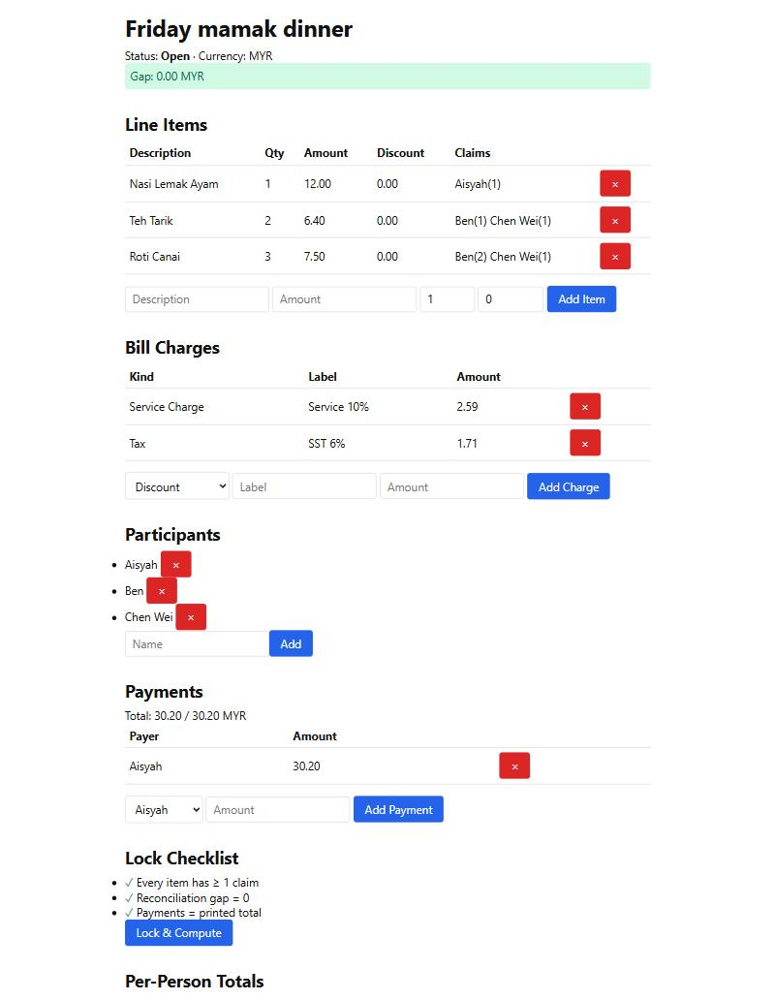
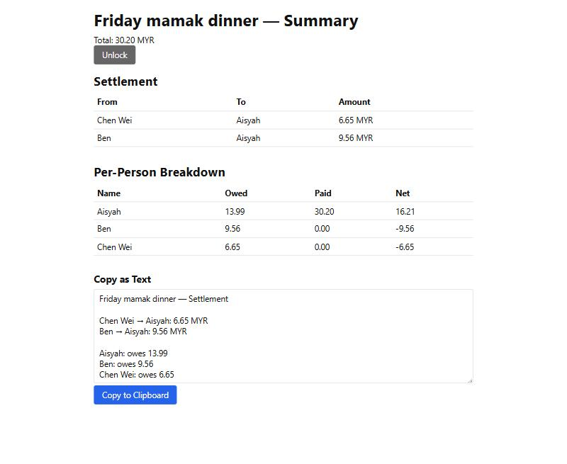
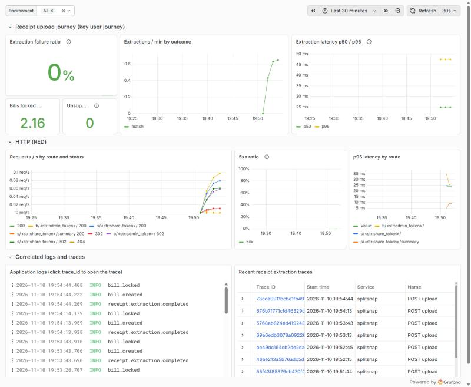
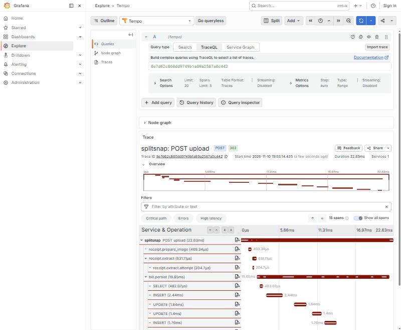
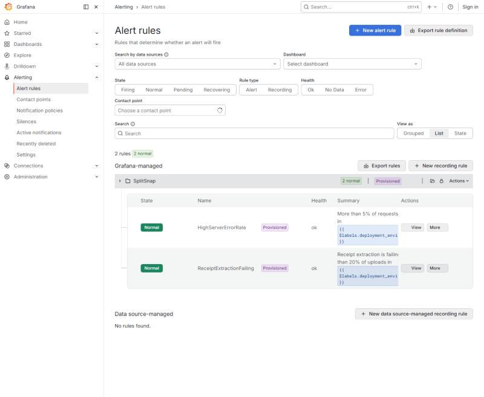

# SplitSnap

**Snap a receipt, split the bill — exactly.**

[](https://github.com/wong80/splitsnap/actions/workflows/ci.yml)
[](https://github.com/wong80/splitsnap/actions/workflows/cd-dev.yml)

SplitSnap turns a photo of a restaurant receipt into a fair, exact settlement: who owes whom, to the last sen, in the fewest transfers. There are no accounts and nothing to install. The organizer uploads the receipt, friends tick what they ate on a shared link, and the app does the maths.

| Organizer review page | Settlement summary |
|---|---|
|  |  |

---

## Contents

1. [The problem](#the-problem)
2. [What it does](#what-it-does)
3. [Expected behaviour](#expected-behaviour-the-rules)
4. [Quickstart](#quickstart-one-command)
5. [Testing](#testing)
6. [Architecture](#architecture)
7. [How the project is run: agent team and tracker](#how-the-project-is-run-agent-team-and-tracker)
8. [Delivery: CI/CD and environments](#delivery-cicd-and-environments)
9. [Observability, alerting and on-call](#observability-alerting-and-on-call)
10. [Where to find the evidence](#where-to-find-the-evidence)
11. [Configuration](#configuration) · [Commands](#management-commands) · [Limitations](#known-limitations)

---

## The problem

After a group meal, one person pays and then has to work out who owes what. That is tedious and easy to get wrong:

- **Typing in the receipt is slow.** A typical receipt has 10–20 lines, plus service charge, tax, vouchers and rounding.
- **Splitting is not "divide by N".** People order different things, share some dishes unevenly ("I had 2 of the 3 roti"), and bill-level charges like service and tax should follow what each person actually ate.
- **Rounding leaks money.** RM 10.00 split three ways is 3.33 + 3.33 + 3.33 = 9.99. Somebody has to absorb the missing sen, and floating-point maths makes it worse.
- **Settling up takes too many transfers** when several people paid part of the bill.

## What it does

| Step | Who | What happens |
|---|---|---|
| 1. **Upload** | Organizer | Takes a photo of the receipt (JPEG, PNG, WEBP or HEIC, up to 10 MB). EXIF and GPS data are stripped. |
| 2. **Extract** | System | A vision LLM (Anthropic Claude) reads the line items, item discounts, bill-level charges (tax, service, vouchers, rounding), the printed total and the currency. If the lines don't add up to the printed total, it retries **once** with the gap as feedback. |
| 3. **Review** | Organizer | Edits items and charges while watching a live **reconciliation gap** (items + charges − printed total). A one-click adjustment line covers small mismatches. Confirming moves the bill to *open*. |
| 4. **Share** | Organizer → Friends | The organizer's page is a private **admin link**, and friends get a **share link**. Both are unguessable 256-bit tokens, so nobody needs an account. |
| 5. **Claim** | Friends | Each friend picks "I am …" (or adds their name), ticks the items they had, and sets **weights** for uneven sharing (weight 2 vs 1 = twice the share). |
| 6. **Pay** | Organizer | Records who actually paid and how much. One or more payers are allowed. |
| 7. **Lock** | Organizer | Freezes the bill and computes each person's share and the **settlement**: who pays whom, and how much. Unlocking is allowed if something changes. |
| 8. **Summary** | Everyone | A per-person breakdown, plus a copy-as-text settlement to paste into a group chat. |

## Expected behaviour (the rules)

- **Exact money.** All amounts are stored as integers in the currency's minor unit (sen, cents, whole yen). People's shares always add up to the bill total **exactly**. Property-based tests enforce this.
- **Fair rounding.** Each amount is split by weight using the largest-remainder method: leftover cents go to the largest fractional parts, and ties go to the participant ID that sorts first. Nobody is off by more than one minor unit, and the same input always gives the same output.
- **Charges follow consumption.** Each bill-level charge is split in proportion to each person's item subtotal. Negative charges such as vouchers reduce shares in the same proportion.
- **A bill can be locked only when** every line item has at least one claim, the reconciliation gap is 0, payments add up to the printed total, and item subtotals are positive whenever charges exist.
- **Minimal transfers.** The settlement repeatedly pairs the largest debtor with the largest creditor, so it never needs more than n − 1 transfers.
- **Friends can't tamper.** The share link can only identify, claim and set weights. Editing items, charges, payments and lock state requires the admin link.
- **Unsupported currencies are handled, never guessed.** If a receipt is in a currency SplitSnap doesn't support (e.g. INR), the bill is created with a warning. The organizer must pick a supported currency before confirming.
- **Changing currency keeps the numbers.** Switching currency during review re-expresses every amount in the new currency's decimal places (RM 50.00 → ¥50). A change that would lose precision (RM 12.50 → JPY) is refused, and nothing is modified.
- **Retention.** Unlocked drafts are purged after 7 days, and locked bills 30 days after locking, together with their images.
- **Limits.** 10 uploads per hour per IP, at most 2 model calls per upload, and up to 20 participants per bill. Supported currencies: MYR, SGD, USD, THB, EUR, GBP, AUD, CAD, CNY, HKD, TWD, IDR, PHP, VND, JPY and KRW.

The domain glossary is in [`CONTEXT.md`](CONTEXT.md), and the original product spec is in [`_docs/plan.md`](_docs/plan.md).

## Quickstart (one command)

Requires Docker. No API key is needed.

```bash
docker compose up --build
```

| URL | What |
|---|---|
| http://localhost:8000 | SplitSnap, with the **demo extractor** on by default: every upload becomes a realistic, reconciled MYR receipt |
| http://localhost:3000 | Grafana: the SplitSnap dashboard, traces, logs and alert rules (anonymous access, bound to localhost) |

This starts the web app (gunicorn, migrations applied on start), PostgreSQL 16 and the Grafana LGTM telemetry stack.

- **Synthetic traffic:** add `--profile probe` to run the journey every 30 s.
- **Ports in use?** Use `WEB_PORT=8010 GRAFANA_PORT=3010 docker compose up --build`.
- **Real receipt extraction:** put `RECEIPT_EXTRACTOR=anthropic` and `ANTHROPIC_API_KEY=…` in a `.env` file.

**Without Docker** (SQLite, fake extractor):

```bash
uv sync --group dev
uv run python manage.py migrate
uv run python manage.py runserver
```

## Testing

One command runs everything:

```bash
uv run pytest                 # 192 tests: unit + integration
uv run pytest -m unit         # 115 tests, pure logic, no database (~5 s)
uv run pytest -m integration  # 77 tests, Django client + database, including the full user journey
uv run ruff check . && uv run ruff format --check .
```

| Level | Location | Covers |
|---|---|---|
| **Unit** | [`tests/unit/`](tests/unit/) | Splitting engine and settlement, including Hypothesis property tests (parts always sum to the whole); money conversion and currency rescaling; receipt schema, validation and image preparation; the demo extractor; telemetry helpers and redaction; the alert relay; guards on the alert rules and dashboard |
| **Integration** | [`tests/integration/`](tests/integration/) | Views, models, purge command and health check against a real database. [`test_journey.py`](tests/integration/test_journey.py) walks upload → review → participants → claims (with weights) → payment → lock → summary. [`test_probe.py`](tests/integration/test_probe.py) runs the same journey over real HTTP. [`test_telemetry.py`](tests/integration/core/test_telemetry.py) asserts that spans, logs and metrics correlate and that no tokens or names leak. |

CI runs both suites against **PostgreSQL 16**, with an 80% coverage gate (currently 89%). A separate CI job boots the full Docker Compose stack and runs the journey probe against it.

## Architecture

```
Browser (Django templates + HTMX)
   │  admin link /b/<token>/      share link /s/<token>/
   ▼
Django 5.2 / gunicorn ─────────► PostgreSQL 16
   │  bills/      models, views, purge
   │  receipts/   image prep → extractor (anthropic | demo | fake) → validation + retry
   │  splitting/  pure Python: money, allocation, settlement
   │  core/       healthz, telemetry, journey probe
   ├──► Anthropic vision API
   └──► OTLP ──► Grafana LGTM (Collector · Tempo · Loki · Prometheus · Grafana)
                      └── alert webhook ──► ops/alert_relay.py ──► incident issue + On-call agent
```

The frontend is server-rendered: every interaction is an HTTP request to a Django view that returns HTML. Routes, the bill lifecycle and module boundaries are in [`docs/architecture.md`](docs/architecture.md). Architecture decisions are in [`docs/adr/`](docs/adr/).

## How the project is run: agent team and tracker

SplitSnap is built and operated by a team of **Claude Code agents** with one human owner. They coordinate through public GitHub Issues and PRs, so every hand-off leaves a trace.

| Role | Definition | Does | Never does |
|---|---|---|---|
| Planner | [`.claude/agents/planner.md`](.claude/agents/planner.md) | Turns requests into issues with a goal and **acceptance criteria** | Write code |
| Implementer | [`.claude/agents/implementer.md`](.claude/agents/implementer.md) | Test-first change on its own branch, PR with `Closes #N` | Merge or deploy |
| QA | [`.claude/agents/qa.md`](.claude/agents/qa.md) | Unit and integration tests, the journey test | Weaken assertions |
| Reviewer | [`.claude/agents/reviewer.md`](.claude/agents/reviewer.md) | Checks every acceptance criterion against the glossary, ADRs and guardrails | Push commits |
| On-call | [`.claude/agents/oncall.md`](.claude/agents/oncall.md) | Woken by an alert: investigates telemetry, regression test, fix PR, postmortem | Touch production |
| Human owner | – | Prioritises, merges, approves production | – |

- [`AGENTS.md`](AGENTS.md) is the entry point every agent reads: commands, guardrails and a map to the modular docs. [`CLAUDE.md`](CLAUDE.md) imports it.
- [`docs/team.md`](docs/team.md) covers roles, hand-off rules and escalation.
- [`docs/process.md`](docs/process.md) covers the delivery flow: issue → PR → CI → dev → prod, and alert → on-call.
- **Tracker:** [GitHub Issues](https://github.com/wong80/splitsnap/issues). Templates require acceptance criteria. Labels show the type (`type:*`), the owning agent (`agent:*`) and the roadmap phase (`phase:*`), and milestones group the phases.

## Delivery: CI/CD and environments

Everything is self-hosted on GitHub plus one machine with Docker. **No third-party sign-up or free trial is required.**

```
PR ──► CI ──merge──► main ──► CI ──► CD dev ──────────────► dev ──► Promote to production ──approval──► prod
       lint, unit,                   build ghcr.io/…:<sha>    smoke    (manual, same image)              smoke via
       integration,                  deploy on self-hosted    probe                                       public URL
       container probe               runner
```

| Stage | Workflow | Trigger | Gate |
|---|---|---|---|
| CI | [`ci.yml`](.github/workflows/ci.yml) | every PR and push to `main` | Lint, format, unit, integration (Postgres), migrations check, `check --deploy`, Compose stack and journey probe |
| CD to dev | [`cd-dev.yml`](.github/workflows/cd-dev.yml) | CI passed on a push to `main` | Builds `ghcr.io/wong80/splitsnap:<sha>`, deploys it with [`deploy/deploy.sh`](deploy/deploy.sh), smoke-tests with the journey probe, and auto-restores the previous image on failure |
| Production | [`promote-prod.yml`](.github/workflows/promote-prod.yml) | **manual**, with a commit SHA | The SHA must already have a successful dev deployment. Requires approval on the `production` environment, deploys the **same image**, then runs the journey probe through the public URL |

| Environment | URL | Notes |
|---|---|---|
| dev | http://localhost:8001 on the runner machine | Demo extractor, synthetic probe every 60 s |
| prod | http://localhost:8002, plus a public `https://<random>.trycloudflare.com` | The Cloudflare quick tunnel needs no account. The URL is printed in the promote run's summary and on *Environments → production*. |

**Deployment status.** The pipeline is complete and the `build` job of *CD dev* passes on `main`. The `deploy-dev` and `promote` jobs run on a self-hosted runner. Until that is registered ([`deploy/runner/`](deploy/runner/README.md)), they wait in the queue. Bringing up the environments by hand uses the same script the workflows run:

```bash
deploy/deploy.sh dev  ghcr.io/wong80/splitsnap:<sha>      # or a locally built image tag
deploy/deploy.sh prod ghcr.io/wong80/splitsnap:<sha>      # starts the public tunnel and prints the URL
deploy/deploy.sh prod --rollback                          # previous image
```

Runner setup, environments, rollback and the trade-offs of the no-sign-up approach are in [`docs/deployment.md`](docs/deployment.md).

## Observability, alerting and on-call



- **Key user journey instrumented:** *upload a receipt → extraction → review*. The journey is covered by all three signals:
  - **Traces:** the HTTP request, image preparation, each extraction attempt (exceptions recorded), validation and bill persistence, plus SQL spans.
  - **Metrics:** `splitsnap_extraction_total{outcome}`, `splitsnap_extraction_duration_seconds`, `splitsnap_bills_locked_total`, and HTTP RED metrics by route.
  - **Structured JSON logs:** every line carries `trace_id` and `span_id`.
- **One trace ID** joins all three. Responses also return it as `X-Trace-ID`.
- **No customer data in telemetry:**
  - Admin and share tokens are scrubbed from URLs, and metrics use route templates.
  - Client IPs are redacted.
  - Item descriptions, names and amounts are never recorded.
  - A test runs the journey and asserts nothing sensitive is exported.
- **Collected, stored and viewable** in a self-hosted Grafana LGTM stack: OTel Collector → Tempo, Loki and Prometheus → Grafana. The dashboard and alert rules are provisioned from [`observability/`](observability/).

| One upload, one trace | User-impact alerts |
|---|---|
|  |  |

**Alerts on user impact** ([`splitsnap-alerts.yaml`](observability/grafana/alerting/splitsnap-alerts.yaml), each with a [runbook](docs/runbooks/)):

| Alert | Fires when |
|---|---|
| `HighServerErrorRate` | 5xx responses > 5% of requests for 2 min |
| `ReceiptExtractionFailing` | > 20% of extractions end in `error` for 2 min |

**On-call agent.** Each alert goes to the [alert relay](ops/alert_relay.py). The relay opens a `type:incident` issue and wakes the On-call agent, which is Claude Code running `--agent oncall` in a fresh worktree (or [`oncall.yml`](.github/workflows/oncall.yml) on the runner). The agent reads the runbook, queries Tempo, Loki and Prometheus, writes a failing test, fixes the bug and opens a PR. It cannot merge or touch production.

**It has been exercised end to end** ([drill record](docs/incidents/2026-10-29-oncall-drill.md)):

1. Receipts in an unsupported currency made the organizer page return 500.
2. Grafana fired both alerts, and the relay opened [#30](https://github.com/wong80/splitsnap/issues/30) and [#31](https://github.com/wong80/splitsnap/issues/31).
3. The woken agent traced the failure to `ValueError: Unsupported currency: INR`. It opened [#32](https://github.com/wong80/splitsnap/pull/32) with regression tests and a [postmortem](docs/incidents/2026-10-29-unsupported-currency-500.md).
4. The Reviewer agent requested changes. They were made, and the human owner merged.
5. Follow-ups [#35](https://github.com/wong80/splitsnap/issues/35) and [#30](https://github.com/wong80/splitsnap/issues/30) were fixed in [#36](https://github.com/wong80/splitsnap/pull/36) and [#37](https://github.com/wong80/splitsnap/pull/37).

Details are in [`docs/observability.md`](docs/observability.md) and [`docs/runbooks/`](docs/runbooks/).

## Where to find the evidence

| Area | Where to look |
|---|---|
| Problem and expected behaviour | This README: [the problem](#the-problem), [what it does](#what-it-does), [the rules](#expected-behaviour-the-rules) |
| Specification and tracker | Spec in [`_docs/plan.md`](_docs/plan.md) and [`_docs/grilling-amendments.md`](_docs/grilling-amendments.md). Public [issues](https://github.com/wong80/splitsnap/issues?q=is%3Aissue) with acceptance criteria. Agent pick-up and hand-off comments on [#2–#18](https://github.com/wong80/splitsnap/issues?q=is%3Aissue+label%3Aphase%3A0-docs%2Cphase%3A1-containers%2Cphase%3A2-delivery%2Cphase%3A3-observability%2Cphase%3A4-oncall). [PRs](https://github.com/wong80/splitsnap/pulls?q=is%3Apr) closing them, with Reviewer comments. |
| Agent team | [`docs/team.md`](docs/team.md), [`docs/process.md`](docs/process.md), [`.claude/agents/`](.claude/agents/) |
| Context management | [`AGENTS.md`](AGENTS.md), which maps to modular docs: architecture, team, process, deployment, observability, runbooks, incidents, ADRs, glossary |
| Application | `docker compose up --build`. Frontend (templates + HTMX) → Django → PostgreSQL |
| Testing | `uv run pytest`: 115 unit + 77 integration, all passing; [CI runs](https://github.com/wong80/splitsnap/actions/workflows/ci.yml) |
| Containerization | [`Dockerfile`](Dockerfile), [`compose.yaml`](compose.yaml) (app + Postgres + telemetry) |
| Deployment | [`deploy/`](deploy/), [`docs/deployment.md`](docs/deployment.md); [status above](#delivery-cicd-and-environments) |
| CI/CD | [`ci.yml`](.github/workflows/ci.yml), [`cd-dev.yml`](.github/workflows/cd-dev.yml) (auto to dev), [`promote-prod.yml`](.github/workflows/promote-prod.yml) (manual, approval-gated) |
| Observability | [`core/telemetry.py`](core/telemetry.py), [`docs/observability.md`](docs/observability.md), screenshots above |
| Alerting | [`observability/grafana/alerting/`](observability/grafana/alerting/), [`docs/runbooks/`](docs/runbooks/) |
| On-call agent | [`ops/alert_relay.py`](ops/alert_relay.py), [`.claude/agents/oncall.md`](.claude/agents/oncall.md), incidents [#30](https://github.com/wong80/splitsnap/issues/30) and [#31](https://github.com/wong80/splitsnap/issues/31), agent PR [#32](https://github.com/wong80/splitsnap/pull/32), [`docs/incidents/`](docs/incidents/) |

## Configuration

| Variable | Default | Description |
|---|---|---|
| `DJANGO_SETTINGS_MODULE` | `config.settings.prod` in Docker | `config.settings.dev` or `config.settings.prod` |
| `DJANGO_SECRET_KEY` | – (required in prod) | Django secret key. `deploy.sh` generates one per environment. |
| `DATABASE_URL` | SQLite in dev | PostgreSQL connection string |
| `ALLOWED_HOSTS` / `CSRF_TRUSTED_ORIGINS` | – | Comma-separated. prod allows `.trycloudflare.com`. |
| `HTTPS_ONLY` | `true` | `false` for plain-HTTP stacks. Disables the SSL redirect, HSTS and secure cookies. |
| `RECEIPT_EXTRACTOR` | `fake` (dev settings) / `demo` (compose) | `anthropic`, `demo` (sample receipt) or `fake` (empty, for tests) |
| `DEMO_RECEIPT` | `demo_receipt` | Fixture used by the demo extractor (`demo_receipt_inr` reproduces the on-call drill) |
| `ANTHROPIC_API_KEY` / `RECEIPT_MODEL` | – | Required for `RECEIPT_EXTRACTOR=anthropic` |
| `OTEL_EXPORTER_OTLP_ENDPOINT` | – (telemetry off) | e.g. `http://lgtm:4318` |
| `OTEL_SERVICE_NAME` / `DEPLOY_ENV` | `splitsnap` / `local` | Service name and `deployment.environment.name` |
| `ALERT_RELAY_URL` / `ALERT_RELAY_TOKEN` | `http://host.docker.internal:9095/alert` / generated | Where Grafana sends alerts, and the shared bearer token |
| `WEB_PORT` / `GRAFANA_PORT` | `8000` / `3000` | Host ports for the local compose stack |
| `MEDIA_ROOT`, `R2_*`, `SENTRY_DSN` | – | Receipt image storage (local volume, or R2/S3 when `R2_BUCKET_NAME` is set); optional Sentry |

## Management commands

```bash
uv run python manage.py probe_journey --base-url http://localhost:8000   # synthetic end-to-end check
uv run python manage.py purge_expired_bills                              # delete expired bills + images
uv run python manage.py eval_receipts                                    # extraction eval suite (needs API key)
python ops/alert_relay.py --mode local                                   # alert → incident → On-call agent
python observability/build_dashboard.py                                  # regenerate the Grafana dashboard JSON
```

## Known limitations

- **Self-hosted delivery** depends on the runner machine being on. The quick-tunnel URL changes when the tunnel restarts. See [`docs/deployment.md`](docs/deployment.md#limitations-trade-offs-of-the-no-sign-up-approach).
- **Extraction is synchronous.** One request waits for at most 2 model calls; p95 is tracked against a 30 s target.
- **Open backlog:** [#19–#24](https://github.com/wong80/splitsnap/issues?q=is%3Aissue+is%3Aopen). These cover live claim updates, showing the receipt image on review, moving an open bill back to review, upload UX, a summary snapshot test, and a larger eval set.
