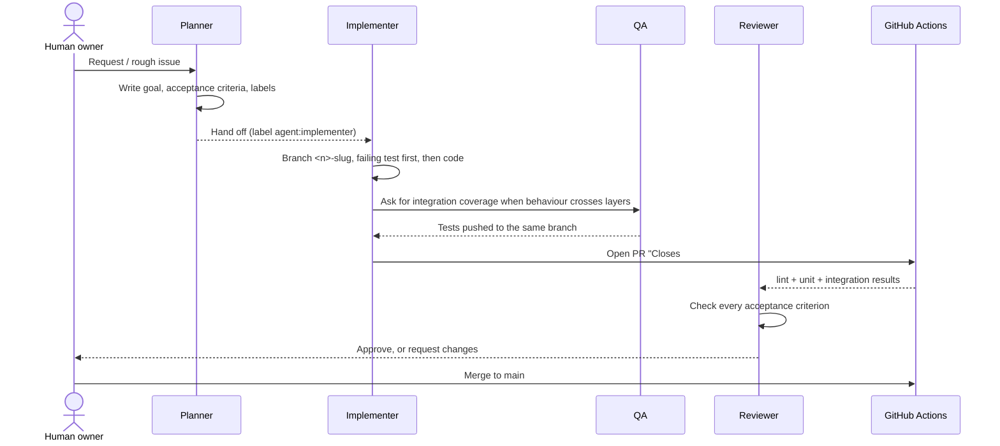

# Delivery process

How a change goes from an idea to production. The roles referenced here are defined in [`team.md`](team.md).

## 1. Track: public GitHub Issues

All work lives in [GitHub Issues](https://github.com/wong80/splitsnap/issues).

- **Templates** ([`.github/ISSUE_TEMPLATE/`](../.github/ISSUE_TEMPLATE/)) require a goal and an **Acceptance criteria** checklist. Feature, bug and incident templates are available.
- **Labels:**
  - `type:*` says what kind of work it is: feature, bug, incident or chore.
  - `agent:*` says which role owns the issue right now.
  - `phase:*` groups the delivery roadmap.
- **Milestones** group issues into phases.
- The original planning documents (`_docs/plan.md`, `_docs/grilling-amendments.md`) are the product spec. `_docs/backlog.md` is now archived, and its open items live as issues.

## 2. Build: issue → branch → PR



**Definition of done** for every PR:

- Each acceptance criterion in the linked issue is met and ticked.
- `uv run pytest` passes locally and CI is green: lint, format, the unit suite, the integration suite, migrations check and the deploy check.
- Docs are updated when behaviour, commands or environment variables change. AGENTS.md says which doc owns what.
- No secrets, tokens or customer data appear in code, logs or telemetry.

## 3. Ship: CI → dev (automatic) → production (manual)

```
PR ──► CI (ci.yml) ──merge──► main ──► CI again ──► CD (cd-dev.yml) ──► dev ──► promote-prod.yml ──approval──► production
        lint, unit,                                   build image          smoke      manual trigger,
        integration                                   ghcr.io/…:<sha>      probe      same image tag
```

| Stage | Workflow | Trigger | Gate |
|---|---|---|---|
| CI | [`ci.yml`](../.github/workflows/ci.yml) | every PR and push to `main` | lint, unit and integration tests, migrations check, deploy check |
| CD to dev | [`cd-dev.yml`](../.github/workflows/cd-dev.yml) | CI succeeded on `main` | Smoke test: `/healthz` plus the journey probe |
| Production | [`promote-prod.yml`](../.github/workflows/promote-prod.yml) | manual (`workflow_dispatch`) with the commit SHA | Required reviewer on the `production` environment, then a smoke test |

Production always runs an image that has already passed in dev. The production stage does not rebuild the image; it re-tags the dev image. Details, ports and rollback are in [`deployment.md`](deployment.md).

## 4. Operate: alert → on-call agent → fix

1. Grafana evaluates the [user-impact alert rules](observability.md#alerts).
2. When a rule fires, the webhook reaches the **alert relay** ([`ops/alert_relay.py`](../ops/alert_relay.py)).
3. The relay opens a `type:incident` issue and wakes the **On-call agent**.
4. The agent:
   - follows the runbook,
   - reads the traces and logs for the failing requests,
   - writes a failing test,
   - fixes the bug and opens a PR that closes the incident.
5. The fix follows the normal path: review → merge → CI → dev. The alert resolves in dev, and then the human promotes the fix to production.
6. The agent writes a short postmortem under [`incidents/`](incidents/).
